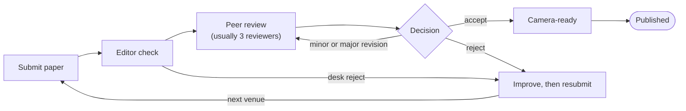

# Academic Papers: From Zero to Expert

A free, self-paced guide to reading, writing and publishing academic papers, from first principles to peer review. Examples lean toward computer science, but the principles hold in any field.

> **About this guide:** drafted with the help of an AI assistant (Claude, by Anthropic) and reviewed by me. It may still contain mistakes: if you spot one, please open an issue or a pull request.
>
> **License:** [CC0 1.0 Universal](LICENSE). Use, copy, adapt or share it freely, no attribution required.

## Contents

- [How to use this book](#how-to-use-this-book)
- [Level 1 · What an academic paper is](#level-1--what-an-academic-paper-is)
- [Level 1 · The publication ecosystem](#level-1--the-publication-ecosystem)
- [Level 1 · Anatomy of a paper](#level-1--anatomy-of-a-paper)
- [Level 2 · Reading papers: the three-pass method](#level-2--reading-papers-the-three-pass-method)
- [Level 2 · Critical reading](#level-2--critical-reading)
- [Level 2 · Finding papers and doing a literature search](#level-2--finding-papers-and-doing-a-literature-search)
- [Level 2 · Managing knowledge](#level-2--managing-knowledge)
- [Level 3 · Before writing](#level-3--before-writing)
- [Level 3 · Writing each section](#level-3--writing-each-section)
- [Level 3 · Academic style](#level-3--academic-style)
- [Level 3 · Figures, tables and results presentation](#level-3--figures-tables-and-results-presentation)
- [Level 3 · Citations and referencing](#level-3--citations-and-referencing)
- [Level 3 · Tools and workflow](#level-3--tools-and-workflow)
- [Level 4 · Submission and peer review](#level-4--submission-and-peer-review)
- [Level 4 · Expert topics](#level-4--expert-topics)
- [Level 4 · Ethics and integrity](#level-4--ethics-and-integrity)
- [Practice](#practice)
- [Glossary and resources](#glossary-and-resources)

## How to use this book

Work through four levels in order; each ends with exercises in the Practice section. Examples lean toward computer science and systems papers (IEEE/ACM style), but the principles hold in any field.

| Level | After it you can | Sections | Time |
| --- | --- | --- | --- |
| 1 · Foundations | Explain what a paper is, where it is published, and what each part does | What a paper is · Ecosystem · Anatomy | 1 week |
| 2 · Reader | Read a paper efficiently, judge its quality, run a literature search | Reading · Critical reading · Finding papers · Managing knowledge | 2–3 weeks |
| 3 · Writer | Plan and write every section of a paper in correct academic style | Before writing → Tools | 4–6 weeks |
| 4 · Expert | Submit, survive review, write surveys and theses, publish reproducibly and ethically | Submission · Expert topics · Ethics | ongoing |

Three habits matter more than any chapter:

- **Read one paper a week** with the three-pass method, and keep notes.
- **Write a little every day**, even 30 minutes. Writing is thinking, not a final step.
- **Get feedback early** from your supervisor or peers on outlines, not just finished drafts.

## Level 1 · What an academic paper is

An academic paper is a written argument that you have added something new and verified to human knowledge. Everything else (format, citations, figures) exists to make that argument easy to check.

### The one idea to remember: the contribution

Every paper must answer: *what do we know now that we did not know before, and why should we believe it?* That new thing is the **contribution**. Typical contributions:

- A new method, algorithm, system or tool
- A new empirical finding (measurement, experiment, user study)
- A new theory, proof or model
- A new dataset or benchmark
- A new synthesis of existing work (surveys)
- A negative result: showing something does *not* work, and why

A paper without a clear contribution is a report, not a paper. Reviewers reject it however well written it is.

### Types of papers

| Type | Length (CS, typical) | What it contributes | Bar to clear |
| --- | --- | --- | --- |
| Full research paper | 8–14 pages (conference), 15–30 (journal) | New method or finding with full evaluation | Novel, sound, significant |
| Short paper / work-in-progress | 2–6 pages | Early idea with preliminary results | Promising and clearly framed |
| Poster / demo paper | 2–4 pages | A working system shown live, or an early idea | Interesting, works |
| Survey / review | 15–40 pages | Organized map of a field, gaps, open problems | Complete, well-structured, insightful taxonomy |
| Systematic literature review | 20–40 pages | Reproducible, protocol-driven review | Rigorous method (search, inclusion criteria) |
| Position / vision paper | 4–8 pages | An argument about where a field should go | Compelling, well-reasoned |
| Experience / industry paper | 6–12 pages | Lessons from building or running real systems | Useful, honest, generalizable lessons |
| Reproducibility study | varies | Re-running someone's experiments | Careful, fair, documented |
| Thesis (bachelor/master/PhD) | 30–300 pages | Demonstrates *you* can do research | Depends on degree; bachelor = competent application |

### Who reads papers and why

- **Reviewers** decide whether it gets published. They are busy and skeptical.
- **Researchers** in your area decide whether to cite or build on it. They read the abstract and figures first.
- **Practitioners** want to know if they can use it.
- **Future you** needs to understand what you did and why.

Write for a smart reader outside your exact niche: a researcher in a neighbouring area.

## Level 1 · The publication ecosystem

In computer science, top conferences often matter as much as journals; in most other fields, journals dominate. Know which world you are in before choosing where to publish.

### Journals vs conferences

|  | Conference | Journal |
| --- | --- | --- |
| Review rounds | Usually one (sometimes a rebuttal) | Several revision rounds |
| Time to decision | 2–4 months, fixed deadline | 3–18 months, submit anytime |
| Length limit | Strict page limit | Looser |
| Presentation | You present a talk or poster | None |
| Weight in CS | High for top venues (e.g. SOSP, OSDI, NSDI, EuroSys) | High; extended conference versions are common |
| Weight elsewhere | Lower | The main currency |

A **workshop** is a small event attached to a conference. It is easier to get into and good for first papers and early ideas.

### Peer review

Experts (usually 3) read your submission and recommend accept, revise or reject.

- **Single-blind:** reviewers know who you are; you don't know them.
- **Double-blind:** neither side knows. You must anonymize: no names, no "our previous work \[5\]", no identifying repo links.
- **Open review:** reviews (sometimes names) are public, e.g. on OpenReview.

Peer review checks plausibility, not truth. Published papers can still be wrong, which is why Level 2 teaches critical reading.

### Preprints

A **preprint** is a paper posted publicly before or without peer review, usually on [arXiv](https://arxiv.org). Benefits: fast visibility, a timestamp for your idea. Risks: readers may treat unreviewed claims as fact. Most CS venues allow preprints; always check the venue's policy, especially for double-blind review.

### Judging venue quality

| Signal | What it measures | Where to check |
| --- | --- | --- |
| CORE ranking (A\*, A, B, C) | Reputation of CS conferences | [CORE portal](https://portal.core.edu.au) |
| SJR quartile (Q1–Q4) | Journal influence within its field | [Scimago](https://www.scimagojr.com) |
| Impact factor | Average recent citations per article | Clarivate Journal Citation Reports |
| Acceptance rate | Selectivity (top CS conferences are often 15–25%) | Venue website |
| Publisher | IEEE, ACM, Springer, Elsevier, USENIX are established | Venue website |
| Your supervisor's opinion | Field-specific reputation no metric captures | Ask |

For *people*, the **h-index** is the largest h such that the person has h papers with at least h citations each. It is crude; never judge a researcher by it alone.

### Predatory venues

Predatory journals and conferences charge fees and publish almost anything. Publishing there harms your reputation. Warning signs:

- Unsolicited emails flattering you and inviting submissions
- Promised review in days, very broad scope, guaranteed acceptance
- Unknown editorial board, fake or vague impact metrics
- Not indexed in Scopus, Web of Science or DBLP (for CS)

When in doubt, ask your supervisor before submitting.

### Open access

Open-access papers are free to read. **Gold OA:** the publisher makes it free, often for an article processing charge (APC). **Green OA:** you post your accepted version in a repository or on your website. Check the publisher's self-archiving policy; most allow green OA.

## Level 1 · Anatomy of a paper

Most papers follow **IMRaD** (Introduction, Methods, Results, and Discussion); CS papers add Related Work and often a Background or Design section. Each part answers one question for the reader.

| Part | Question it answers | Typical size (8–12 page paper) |
| --- | --- | --- |
| Title | What is this about, and is it for me? | 8–15 words |
| Authors & affiliations | Who did it, where? | — |
| Abstract | What did they do, find, and why does it matter? | 150–250 words |
| Keywords / CCS concepts | How is it indexed? | 4–6 terms |
| Introduction | What problem, why it matters, what's new, what are the contributions? | 1–1.5 pages |
| Background | What must the reader know first? | 0.5–1 page |
| Related work | How does it differ from what exists? | 0.5–1.5 pages |
| Method / Design / Approach | What exactly did they do or build? | 2–3 pages |
| Implementation | How was it built (tools, versions, scale)? | 0.5–1 page |
| Evaluation / Results | Does it work? How well, compared to what? | 2–4 pages |
| Discussion | What do results mean? Limitations? Threats to validity? | 0.5–1 page |
| Conclusion & future work | What's the takeaway and what's next? | 0.25–0.5 page |
| Acknowledgements | Who helped or funded it? | 2–4 lines |
| References | What does it build on? | 20–50 entries |
| Appendix / artifact | Proofs, extra results, code and data | Optional |

### Where to look for what

- **The claim:** last paragraphs of the introduction (the contributions list).
- **The evidence:** figures and tables in the evaluation.
- **The weaknesses:** limitations, threats to validity, and what the evaluation *does not* test.
- **The context:** related work, plus the references list.

Systems papers often swap "Method" for **Design** (what and why) and **Implementation** (how). Theory papers replace evaluation with **theorems and proofs**. Survey papers replace method with a **taxonomy**.

## Level 2 · Reading papers: the three-pass method

Never read a paper start to finish on the first go. Use S. Keshav's three-pass method (*How to Read a Paper*, ACM SIGCOMM CCR, 2007): each pass goes deeper, and you can stop after any pass.

### Pass 1 · Bird's-eye view (5–10 minutes)

1. Read title, abstract, and introduction.
2. Read section and subsection headings only.
3. Glance at figures and tables.
4. Read the conclusion.
5. Skim the references; tick the ones you know.

Then answer the **five Cs**:

- **Category:** what type of paper (measurement, system, survey…)?
- **Context:** which papers and theories does it build on?
- **Correctness:** do the assumptions look valid?
- **Contributions:** what are the main ones?
- **Clarity:** is it well written?

Most papers you find stop here. That is normal and efficient.

### Pass 2 · Grasp the content (about 1 hour)

1. Read the whole paper, but skip proofs and fine details.
2. Study every figure: axes, units, error bars, baselines. Sloppy figures often mean sloppy work.
3. Mark terms you don't know and references to read later.
4. Summarize the paper's main thrust, with evidence, to someone else (or in your notes).

If you're lost after pass 2, the reason is one of: unfamiliar background, a poorly written paper, or you're tired. Read background first, or come back later.

### Pass 3 · Virtually re-implement it (4–5 hours beginner, about 1 hour expert)

1. Rebuild the paper's work in your head: same assumptions, your own reasoning.
2. Compare your version to theirs. Differences reveal hidden assumptions and weak spots.
3. Note ideas for future work; this is where your own research ideas come from.
4. Ideally, actually re-run their code or a small experiment.

Do pass 3 only for papers central to your work, or papers you review.

### Reading order for a new field

1. Start with 1–2 **recent surveys** to get the map.
2. Read the **most-cited foundational papers** the surveys point to.
3. Read the **last 2–3 years** of top-venue papers for the current frontier.
4. Read **PhD theses** in the area: their background chapters are the gentlest introductions.

### Tips for non-native English readers

- Don't translate sentence by sentence; read for the claim of each paragraph.
- Build a personal glossary of the field's terms.
- Read the same paper's talk slides or video if available (many venues post them).

## Level 2 · Critical reading

Read every paper as a skeptical reviewer: the authors are making a claim, and your job is to check whether the evidence supports it.

### Ten questions for any paper

1. What exactly is the claim? Can I state it in one sentence?
2. Is the problem real and important, or invented to fit the solution?
3. Is it actually new? Did they miss obvious prior work?
4. Are the assumptions realistic (workload, hardware, user behaviour, threat model)?
5. Are the baselines fair, recent and properly tuned?
6. Does the evaluation measure what the claim is about?
7. Are results repeated, with variance shown (error bars, confidence intervals)?
8. Would the result hold at a different scale, dataset or environment?
9. What do the authors admit as limitations, and what do they not admit?
10. Could I reproduce it from the paper, code and data provided?

### Red flags

| Red flag | Why it matters |
| --- | --- |
| Only one run, no error bars | Differences may be noise |
| Comparing to an old or weak baseline | Inflates improvement |
| "Up to 10× faster" | "Up to" hides the average case |
| Cherry-picked workloads or datasets | Result may not generalize |
| Relative numbers only ("30% better") with no absolute values | 30% of almost nothing is nothing |
| Y-axis not starting at zero, or log scale unmarked | Visually exaggerates differences |
| Claims in abstract stronger than in results | Overselling |
| No limitations or threats-to-validity section | Authors haven't faced the weaknesses |
| Correlation presented as causation | Wrong conclusion |
| p-values without effect sizes, or many tests without correction | Statistically fragile |
| No code, data or configuration details | Can't be verified |

### Basic statistics you must know

- **Mean vs median:** latency and response times are skewed; report median and tail percentiles (p95, p99), not just mean.
- **Standard deviation / confidence interval:** how much results vary between runs.
- **Statistical significance (p-value):** probability of a result this extreme if there were no real effect. p < 0.05 is a convention, not proof.
- **Effect size:** how big the difference is. A significant but tiny effect may not matter.
- **Sample size:** few runs, users or datasets make every conclusion weaker.

### Write a one-paragraph critique

After pass 2, write: *the paper claims X; the evidence is Y; it is convincing because A, but weak because B; I would test C.* This single habit builds both reading and reviewing skill.

## Level 2 · Finding papers and doing a literature search

A good search combines keyword queries in databases with "snowballing" through citations; keyword search alone misses a lot.

### Where to search (CS focus)

| Tool | Best for |
| --- | --- |
| [Google Scholar](https://scholar.google.com) | Broadest coverage, "Cited by" links, alerts |
| [DBLP](https://dblp.org) | Clean CS bibliography; author and venue listings; reliable BibTeX |
| [Semantic Scholar](https://www.semanticscholar.org) | AI-assisted summaries, influential citations |
| IEEE Xplore, ACM Digital Library | Full texts of IEEE/ACM papers (usually free on your university network or VPN; check with the library) |
| Scopus, Web of Science | Curated databases, used for systematic reviews |
| [arXiv](https://arxiv.org) | Newest preprints (cs.DC for distributed computing) |
| Connected Papers, Research Rabbit | Visual maps of related papers |

Can't access a paper? Try the author's website, arXiv, your university library, or email the author: they almost always send it.

### Search strategy

1. **Define the question** in one sentence.
2. **List keywords and synonyms** (e.g. *cache eviction* / *cache replacement* / *caching policy*).
3. **Combine with Boolean operators:** `("cache eviction" OR "cache replacement") AND ("CDN" OR "web caching")`.
4. **Filter** by year, venue quality and citations.
5. **Screen titles, then abstracts**, then do pass 1 on survivors.
6. **Snowball:** go *backward* (the paper's references) and *forward* ("Cited by") from your best 5–10 papers.
7. **Stop** when new searches keep returning papers you already have (saturation).

### Stay up to date

- Google Scholar alerts on your keywords and on key authors
- Follow the proceedings of the 3–5 top venues in your area each year
- arXiv daily listings for your category, or an RSS feed

## Level 2 · Managing knowledge

You will forget most of what you read within weeks, so capture it in a reference manager and a consistent note template from day one.

### Reference manager: Zotero

[Zotero](https://www.zotero.org) is free and open source. Set it up once:

1. Install Zotero and the browser connector: one click saves a paper's metadata and PDF.
2. Install the **Better BibTeX** plugin: it gives each paper a stable citation key (e.g. `keshav2007read`) and auto-exports a `.bib` file for LaTeX.
3. Use **collections** per project (e.g. *Thesis*, *Paper 1*) and **tags** for themes.
4. Annotate PDFs inside Zotero; highlights become searchable notes.
5. Sync to keep your library on every device.

Alternatives: Mendeley, JabRef, or plain BibTeX for minimalists.

### Note template (one per paper)

```markdown
# <Title> (<First author> <year>, <venue>)
Citation key: 
Pass reached: 1 / 2 / 3

## One-sentence summary
## Problem and why it matters
## Approach (key idea)
## Evidence (setup, baselines, main numbers)
## Strengths
## Weaknesses / open questions
## Relevance to my work
## Ideas it gives me
## Papers to follow up
```

### Literature matrix

When you've read 10+ papers on one topic, build a table: one row per paper, one column per dimension you care about. Patterns and gaps jump out, and it becomes the backbone of your related-work section.

| Paper | Problem | Approach | Environment | Metrics | Baselines | Limitation |
| --- | --- | --- | --- | --- | --- | --- |
| Author 2024 |  |  |  |  |  |  |
| Author 2023 |  |  |  |  |  |  |

An empty cell that is empty for *every* paper is often a research gap.

## Level 3 · Before writing

Most bad papers fail before the first sentence: the question, contribution or story was never made clear. Fix these four things first.

### 1. A research question you can answer

Good questions are specific, answerable with your resources, and interesting to others.

| Weak | Better |
| --- | --- |
| How can web caching be improved? | Does a frequency-aware eviction policy raise the cache hit rate over LRU on real CDN traces? |
| Is machine learning good for code review? | Can a small model flag risky pull requests as accurately as senior reviewers on open-source projects? |

Turn the question into **hypotheses** you can test: *H1: the new policy raises the hit rate by at least 5 points over LRU on all three traces.*

### 2. The contribution statement

Write this before anything else, and keep it pinned above your draft:

> We show that **\[result\]** by **\[method\]**, which matters because **\[impact\]**. Unlike **\[closest prior work\]**, we **\[difference\]**.

If you can't fill it in, you're not ready to write; you need more results or a sharper question.

### 3. The story (outline)

A paper is a story with one plot: *problem → gap → idea → evidence → takeaway*. Draft the outline as headings plus one sentence per paragraph. Show it to your supervisor before writing prose. Changing an outline costs minutes; changing a draft costs days.

A useful order of writing, *not* reading order:

1. Figures and tables of your main results
2. Method / design
3. Evaluation
4. Introduction
5. Related work
6. Conclusion
7. Abstract and title (last: now you know what you showed)

### 4. Choose the target venue early

The venue fixes the page limit, template, audience, review style and deadline. Pick it before writing:

- Where did the papers you cite most get published?
- Is your contribution mature enough for a full paper, or better for a workshop?
- Does the deadline fit realistically, with two weeks for feedback and polishing?
- Read 3–5 recent papers from that venue and copy their structure and tone.

For a first paper, a good workshop or a CORE B/A conference is a sensible target. Ask your supervisor.

## Level 3 · Writing each section

Each section has a job and a known shape; follow the shape and most of the writing becomes filling in blanks.

### Title

- State the contribution or finding, not just the topic. *"Frequency-Aware Eviction Raises CDN Cache Hit Rates by 9%"* beats *"A Study of Caching Policies"*.
- Include the 2–3 keywords people will search for.
- Avoid abbreviations unless universally known; avoid "Towards", "Novel", "A New Approach to".
- System name + colon is common in systems papers: *"Foo: Fast Eviction for Large CDN Caches"*.

### Abstract (150–250 words, 5–6 sentences)

Use this formula, one or two sentences each:

1. **Context:** the area and why it matters.
2. **Problem / gap:** what existing approaches fail to do.
3. **Approach:** what you did ("We present / propose / measure…").
4. **Results:** the main numbers. Be concrete: *"reduces p95 latency by 34% and cost by 12%"*.
5. **Implication:** why it matters or what it enables.

No citations, no undefined acronyms, no vague promises ("results are promising"). Many readers read only the abstract.

### Introduction (the most important 1–1.5 pages)

A classic structure ("the funnel"), roughly one paragraph each:

1. **Motivation:** the broad problem and why anyone should care. Use a fact or number.
2. **The specific problem:** narrow down to what you tackle.
3. **The gap:** why existing solutions fall short. Be fair, cite them.
4. **Your idea:** the key insight in plain words.
5. **Results preview:** headline numbers.
6. **Contributions:** a bulleted list of 2–4 concrete contributions.
7. **Roadmap (optional):** "Section 2 describes…". Short papers often skip it.

The contributions list is what reviewers check everything else against. Each bullet should be verifiable: *"We implement X and evaluate it on Y, showing Z"*.

### Background

Only what your target reader needs to follow the paper. Not a textbook chapter. Define each concept once; use the same term from then on.

### Related work

- **Organize by theme, not by paper.** Group prior work into 3–5 categories; for each, say what they do and how you differ.
- **Compare, don't list.** Bad: *"A did X. B did Y. C did Z."* Good: *"Recency-based policies \[A, B\] ignore how often an object is requested; we instead…"*
- **Be generous and accurate.** Reviewers may be the authors you cite. Misrepresenting their work is a fast rejection.
- Place it after the introduction (shows the gap early) or before the conclusion (when readers need your design first to see differences). Both are common.

### Method / design

- Start with an overview, ideally with a figure (architecture or pipeline), then go into components.
- Explain **why** each design choice was made, not just what. Mention alternatives you rejected.
- Give enough detail to reproduce: algorithms in pseudocode, parameters, assumptions.
- State your assumptions and threat model or scope explicitly.

### Evaluation / results

Organize around **questions**, not experiments. Open with them:

> Our evaluation answers: (Q1) Does X reduce latency? (Q2) What does it cost? (Q3) How does it scale? (Q4) Which component matters most?

Then for each question:

1. **Setup:** hardware, software versions, workloads, datasets, metrics, baselines, number of runs.
2. **Result:** a figure or table.
3. **Interpretation:** what it shows and *why* it happens. A result without an explanation is half a result.

Include an **ablation study** (remove one component at a time) to show each part earns its place, and a **sensitivity analysis** for key parameters.

### Discussion and limitations

- What do results mean beyond your setup?
- **Threats to validity:** *internal* (could something else explain results?), *external* (does it generalize?), *construct* (do your metrics measure what you claim?).
- Admit limitations honestly. Reviewers find them anyway; naming them first earns trust.

### Conclusion

One short paragraph restating the problem, approach and main result, plus 1–3 concrete future-work directions. No new results. Don't copy-paste the abstract.

### Acknowledgements and references

Thank funders (with grant numbers), labs and helpers. In double-blind submissions, leave acknowledgements out until the camera-ready version.

## Level 3 · Academic style

Good academic writing is clear, precise and boring in the best way: the reader should notice your ideas, never your prose.

### Paragraphs

- **One idea per paragraph**, stated in the first sentence (the topic sentence). A reader skimming only first sentences should get the whole argument.
- **Old before new:** start sentences with what the reader already knows, end with the new information. This creates flow (Gopen & Swan, *The Science of Scientific Writing*, 1990).
- 3–7 sentences per paragraph.

### Sentences

- Keep subject and verb close together and early.
- Prefer active voice: *"We measured latency"* over *"Latency was measured"*. "We" is normal in CS papers, even with one author in many venues.
- One main claim per sentence; split sentences over about 30 words.
- Use the same term for the same thing every time. Synonyms make readers think you mean different things.

### Precision

| Vague | Precise |
| --- | --- |
| significantly faster | 2.3× faster (median over 10 runs) |
| a lot of data | 1.2 TB of traces from 400 nodes |
| recently | since 2022 |
| it performs well | it reaches 94.1% accuracy, 3.2 points above the best baseline |
| several | four |

Reserve "significant" for statistical significance.

### Hedging: match claim strength to evidence

| Evidence | Wording |
| --- | --- |
| Proven or directly measured | shows, demonstrates, X is |
| Strong but limited | indicates, suggests strongly |
| Partial or indirect | suggests, may, appears to |
| Speculation | we hypothesize, one possible explanation is |

Overclaiming is the most common reason reviewers lose trust. Underclaiming everything makes the paper sound weak. Be exact.

### Common mistakes

- Starting with "In this paper, we…" in every section
- Undefined acronyms (define at first use: *Content Delivery Network (CDN)*)
- "This" without a noun: *"This shows…"* → *"This latency drop shows…"*
- Tense chaos: use present for what the paper shows and general truths, past for what you did in experiments
- Contractions (don't, it's) and informal words (huge, a bunch, pretty good)
- "Obviously", "clearly", "trivially": if it's obvious, you don't need the word; if it isn't, the word annoys
- Figures or tables never referenced in the text

### Tips for non-native English writers

- Write simple sentences first; style comes later.
- Keep a "phrasebank" of useful sentences from papers you admire (the University of Manchester *Academic Phrasebank* is a good start).
- Read your text aloud; stumbles mark problems.
- Use grammar tools (LanguageTool, Grammarly) as a last pass, not a substitute for thinking.
- Articles (a / the) and prepositions are the commonest errors; ask a fluent colleague to check them.

### Revise in passes

1. **Structure:** does each section do its job? Does the story flow?
2. **Paragraphs:** read only first sentences. Is the argument there?
3. **Sentences:** cut words. Most first drafts shrink 20–30% without losing content.
4. **Proofreading:** typos, references, figure numbers, consistency.

## Level 3 · Figures, tables and results presentation

Readers look at figures before text, so each figure must make one point on its own, with a caption that states that point.

### Figure or table?

| Use a… | When |
| --- | --- |
| Line chart | A quantity changes over time or with a parameter (load, cluster size) |
| Bar chart | Comparing a few systems or configurations on one metric |
| CDF plot | Showing a full distribution (latency): common in systems papers |
| Box / violin plot | Comparing distributions across groups |
| Scatter plot | Relationship between two variables |
| Heatmap | Two parameters × one metric |
| Table | Exact values matter, or many different attributes per item |
| Architecture diagram | How components of your system connect |

Avoid pie charts and 3D charts in research papers.

### Rules for good figures

1. **One message per figure.** Write the message in the caption: *"Figure 5: Foo keeps the hit rate above 80% up to a 10 GB cache, while LRU drops below 60%."*
2. **Label axes with units:** *Latency (ms)*, not *Latency*.
3. **Readable fonts:** at least as large as the caption text when printed.
4. **Show variability:** error bars or shaded intervals; say what they represent (std dev, 95% CI, min/max).
5. **Colour-blind safe, greyscale-friendly:** vary line style or markers, not just colour.
6. **Consistent:** same system → same colour and marker in every figure.
7. **Vector formats** (PDF, SVG) for plots; never blurry screenshots.
8. **Reference every figure in the text** and explain what to look at.

### Tables

- Use horizontal rules only (the LaTeX `booktabs` package): no vertical lines, no grid.
- Align numbers by decimal point; same precision within a column.
- **Bold** the best result per column if it helps comparison.
- Put units in the header, not in each cell.

### Tools

- **matplotlib / seaborn** (Python): the standard; script every plot so you can regenerate it when data changes.
- **pgfplots / TikZ** (LaTeX): fonts match the paper perfectly; steeper learning curve.
- **draw.io, Excalidraw, Inkscape:** architecture diagrams.

Keep raw data, plotting scripts and figures together in version control. You will regenerate every figure more times than you expect.

## Level 3 · Citations and referencing

Cite whenever an idea, fact, method, tool, dataset or wording is not yours or not common knowledge in your field. When unsure, cite.

### When to cite

- A claim that isn't your own result: *"Kubernetes is the dominant container orchestrator \[3\]."*
- Every tool, dataset, benchmark and software library you used
- Prior work you build on or compare against
- Direct quotes (rare in CS; paraphrase instead and still cite)

Cite the **original source**, not a paper that mentions it. Cite peer-reviewed versions over preprints when both exist. Only cite what you have actually read, at least to pass 1.

### Citation styles

| Style | In-text looks like | Common in |
| --- | --- | --- |
| IEEE | \[1\], \[2\]–\[4\] | IEEE venues, engineering |
| ACM | \[1\] or (Author Year), depending on template | ACM venues |
| APA | (Keshav, 2007) | Psychology, social sciences, education |
| Harvard | (Keshav 2007) | Business, many UK universities |
| Springer LNCS | \[1\] | Springer conference proceedings |

You rarely format citations by hand: the venue's LaTeX template plus BibTeX does it.

### Citations as words

A citation is not a noun. Write *"Keshav \[7\] proposes…"* or *"…as shown in prior work \[7\]"*, not *"\[7\] proposes…"*.

### BibTeX basics

```latex
@article{keshav2007read,
  author    = {Keshav, S.},
  title     = {How to Read a Paper},
  journal   = {ACM SIGCOMM Computer Communication Review},
  volume    = {37},
  number    = {3},
  pages     = {83--84},
  year      = {2007}
}
```

- Get BibTeX from DBLP or the publisher, not Google Scholar (often incomplete).
- Check every entry: author names, venue full name, year, pages, DOI.
- Protect capitals in titles with braces: `{CDN}`, `{LaTeX}`, or they become lowercase.

### Plagiarism

Plagiarism is presenting others' words or ideas as yours, and it ends academic careers.

- **Copying sentences** without quotes is plagiarism, even with a citation.
- **Patchwriting** (copying and swapping a few words) is plagiarism.
- **Self-plagiarism:** reusing your own published text without disclosure. Allowed in limited cases (thesis from your papers, extended journal versions) only when declared.
- Universities and publishers run similarity checks (Turnitin, iThenticate).

Safe habit: close the source, write from your understanding, then check against the source for accuracy and cite.

## Level 3 · Tools and workflow

Use LaTeX on Overleaf (or locally) with the venue's official template, Git for versions, and Zotero + Better BibTeX for references.

### LaTeX essentials

Most CS venues require LaTeX or strongly prefer it. Learn these first:

```latex
\documentclass[conference]{IEEEtran}   % or acmart, llncs
\usepackage{graphicx, booktabs, amsmath, hyperref, cleveref}

\begin{document}
\title{Foo: Fast Eviction for Large CDN Caches}
\maketitle
\begin{abstract} ... \end{abstract}

\section{Introduction}\label{sec:intro}
As shown in \cref{fig:hitrate}, ... prior work~\cite{keshav2007read}.

\begin{figure}[t]
  \centering
  \includegraphics[width=\columnwidth]{figs/hitrate.pdf}
  \caption{Foo keeps the hit rate high as the cache shrinks.}
  \label{fig:hitrate}
\end{figure}

\bibliographystyle{IEEEtran}
\bibliography{refs}
\end{document}
```

- `\label` + `\cref` keep numbering correct automatically.
- `~` before `\cite` prevents a line break between word and citation.
- Never change the template's margins, fonts or spacing to fit the page limit: desk rejection.

### Common templates

| Template | Used by |
| --- | --- |
| `IEEEtran` | IEEE conferences and journals |
| `acmart` (sigconf, acmsmall) | ACM conferences and journals |
| `llncs` | Springer LNCS proceedings |
| `elsarticle` | Elsevier journals |
| University thesis template | Your thesis: ask your department |

### Writing environment

- **[Overleaf](https://www.overleaf.com):** browser LaTeX, real-time collaboration with co-authors and supervisor, comments and history. Best default for collaboration.
- **Local:** VS Code + LaTeX Workshop extension, or TeXstudio; TeX Live distribution. Faster, works offline, plays well with Git.
- **Git:** one sentence per line in `.tex` files makes diffs and reviews readable. Overleaf can sync with GitHub.
- **Folder layout:** `paper.tex`, `sections/`, `figs/`, `data/`, `scripts/`, `refs.bib`.

### A sustainable writing routine

- Fixed daily writing time, even 30–60 minutes. Consistency beats binges.
- Write the ugly first draft fast; edit later. Don't polish sentences in paragraphs you might delete.
- Use `\todo{}` (todonotes package) to mark gaps and keep moving.
- Set internal deadlines: full draft 2–3 weeks before the venue deadline, so co-authors can review.

## Level 4 · Submission and peer review

Rejection and revision are the normal path, not failure: even strong papers are often rejected or sent back for revision before they are accepted.



*Every decision except accept sends the paper back for more work.*

Conferences usually make one decision (sometimes after a rebuttal); journals loop through revisions until accept or reject.

### Submitting

1. Read the call for papers (CFP) fully: topics, page limit, template, anonymity rules, deadlines (abstract registration is often a week before the paper).
2. Register on the submission system (HotCRP, EasyChair, OpenReview, Microsoft CMT, or the journal's own) days before the deadline.
3. Declare conflicts of interest (your supervisor, recent co-authors, your institution).
4. For journals, write a short **cover letter**: what the paper contributes and why it fits the journal.
5. Submit early; update until the deadline if the system allows.

### How reviewers read your paper

A reviewer typically spends a few hours per paper and answers: *Is it novel? Is it correct? Is it significant? Is it clear? Does it fit the venue?* They read abstract, introduction and figures first and form an opinion quickly. Make that first impression clear and honest.

A typical review contains a summary, strengths, weaknesses, questions for authors, and a score (e.g. strong accept → strong reject) with a confidence level.

### Responding to reviews

1. **Wait a day** before responding. First reactions are emotional.
2. Sort comments: misunderstandings (your writing was unclear), fair criticisms (fix them), and disagreements (argue politely with evidence).
3. A reviewer who misunderstood is telling you the paper is unclear; fix the text, not the reviewer.

**Rebuttal (conferences):** short (often 500–1000 words). Answer the most important concerns first, with facts and numbers. No new claims you can't deliver. Polite and specific.

**Response letter (journals):** quote every comment, then reply and say exactly what changed and where:

```markdown
**Reviewer 2, Comment 3:** The evaluation uses only one workload.

**Response:** We agree. We added two workloads (an e-commerce trace and a
video-streaming trace) in Section 6.3 and Figure 9. Results are consistent: ...
```

Never ignore a comment. If you disagree, explain why respectfully.

### Handling rejection

- Read the reviews for the 2–3 recurring themes; those are the real problems.
- Improve the paper before resubmitting: the same reviewers may appear at the next venue.
- Resubmit to an appropriate venue; a short gap is fine, but don't let the paper die in a drawer.
- Track submissions, reviews and changes in one document per paper.

### After acceptance

Prepare the **camera-ready** (de-anonymize, add acknowledgements, address required changes), sign the copyright or licence form, post a green-OA version if allowed, and prepare the talk or poster. Release your code and data.

## Level 4 · Expert topics

At expert level the differences are rigor and reproducibility: anyone should be able to check, repeat and build on your work.

### Writing a survey or systematic review

A survey's contribution is its **taxonomy**: a new way of organizing a field that reveals patterns and gaps.

- **Narrative survey:** expert-chosen papers, organized by taxonomy. Faster; vulnerable to bias.
- **Systematic literature review (SLR):** a published protocol makes it reproducible. In software engineering follow Kitchenham's guidelines; in health and many other fields, PRISMA.

SLR steps:

1. Research questions (RQ1–RQ4)
2. Search string and databases, written down in advance
3. Inclusion and exclusion criteria (years, venue types, language)
4. Screening: titles → abstracts → full text, ideally by two people independently
5. Quality assessment of included studies
6. Data extraction into a fixed form (your literature matrix)
7. Synthesis: taxonomy, tables, trends, open challenges
8. Report numbers at each step (a PRISMA-style flow diagram)

### Reproducibility and artifacts

Many CS venues (ACM, USENIX) run **artifact evaluation**: reviewers try to run your code. ACM awards badges such as *Artifacts Available*, *Artifacts Evaluated (Functional / Reusable)* and *Results Reproduced*.

Make your work reproducible:

- Public repository (GitHub) plus a permanent archived copy with a DOI (Zenodo)
- Pinned versions: container images, `requirements.txt`, Helm chart versions, Kubernetes version
- Scripts that run every experiment and regenerate every figure from raw data
- A README: hardware needed, expected runtime, one command per experiment
- Infrastructure as code (Terraform, Ansible) for cluster setup

Treat experiments like a CI pipeline: if it can't run from a clean checkout, it isn't reproducible.

### Experimental rigor in systems papers

The classic book is Raj Jain, *The Art of Computer Systems Performance Analysis* (1991). Common "benchmarking crimes" to avoid:

| Crime | Fix |
| --- | --- |
| Single run | 10+ runs; report median and spread or CI |
| No warm-up | Discard warm-up period; state it |
| Unrealistic workload | Use real traces or standard benchmarks; justify synthetic ones |
| Untuned baseline | Tune baselines as carefully as your system; report settings |
| Hiding the setup | Report hardware, OS, kernel, versions, configuration |
| Only the metric you win on | Report trade-offs (cost, CPU, memory, complexity) |
| Noisy shared environment | Dedicated nodes, or quantify noise; cloud variance is real |
| Mean of skewed data | Report percentiles (p50, p95, p99) and CDFs |

### Writing a thesis

A thesis proves *you* can do research independently; a paper proves a *result*.

- Typical bachelor's structure: introduction → background → related work → design → implementation → evaluation → conclusion.
- Background chapters are longer than in papers: explain the technologies (e.g. the frameworks and tools you build on) to an examiner outside your niche.
- Agree scope, outline and timeline with your supervisor first; send chapters for feedback as you go.
- A thesis can produce a paper: write the paper's core results first, then expand them.
- Check your university's rules: language, length, template, plagiarism check, submission dates.

## Level 4 · Ethics and integrity

Research only works because readers trust that what is reported actually happened; every rule below protects that trust.

### Authorship

- An author made a substantial intellectual contribution *and* can stand behind the paper. Supplying funding or equipment alone isn't authorship.
- Agree on author list and order **early**, and revisit as contributions change.
- In CS the first author usually did most of the work; the supervisor is often last. Conventions differ by field (some sort alphabetically).
- Many publishers ask for a contribution statement using the **CRediT** taxonomy (Conceptualization, Software, Writing – original draft…).

### Research misconduct

| Misconduct | Meaning |
| --- | --- |
| Fabrication | Inventing data or results |
| Falsification | Manipulating data, experiments or images; dropping inconvenient runs without saying so |
| Plagiarism | Taking others' words or ideas without credit |
| Duplicate submission | Sending the same paper to two venues at once |
| Salami slicing | Splitting one result into many tiny papers |
| Citation manipulation | Citing yourself or friends without reason; citation rings |

Honest mistakes are not misconduct: if you find an error after publication, contact the editor and publish a correction. That is respected.

### Data and human subjects

- Excluding outliers or failed runs is fine *if* you state the rule and apply it to all systems equally.
- User studies, interviews or personal data need ethics-board approval and informed consent; in the EU, GDPR applies.
- Respect licences of datasets and code you reuse.

### Using AI tools responsibly

Policies are evolving; always read the specific venue's and university's current policy.

- Major publishers and COPE agree that AI tools **cannot be authors**: they can't take responsibility.
- Most require **disclosure** of substantive AI use (drafting text, generating code or figures), usually in the methods or acknowledgements.
- **You** are fully responsible for every word, number and citation. AI tools can invent plausible but non-existent references: verify every citation in DBLP or the publisher's site.
- Generally acceptable: grammar and language polishing, brainstorming, explaining concepts, coding help (disclosed where required).
- Not acceptable: AI-generated data or results, unverified literature claims, or uploading confidential manuscripts you are reviewing to AI tools.

A good rule: use AI as you would a knowledgeable colleague, and never let it be the source of a fact you haven't checked.

## Practice

Skills come from doing: complete each level's exercises before moving on, and use the two checklists on every paper you read or write.

### Exercises by level

**Level 1 · Foundations**

- [ ] Pick 3 papers from one top venue in your area. For each, label every section with its job (anatomy table).
- [ ] Find the CORE rank of 5 conferences and the SJR quartile of 3 journals in your field.
- [ ] For one paper, write its contribution in one sentence.

**Level 2 · Reader**

- [ ] Do pass 1 on 10 papers in one week; answer the five Cs for each.
- [ ] Do pass 2 on 3 of them; write a one-paragraph critique each.
- [ ] Do pass 3 on 1 paper central to your work; list 3 hidden assumptions.
- [ ] Run a structured search on your thesis topic; build a 15-paper literature matrix.
- [ ] Set up Zotero + Better BibTeX and Google Scholar alerts.

**Level 3 · Writer**

- [ ] Write the contribution statement and outline for your thesis or first paper; get feedback.
- [ ] Rewrite the abstract of a published paper using the 5-part formula; compare with the original.
- [ ] Write a related-work section for your topic organized by theme (3–5 themes).
- [ ] Make one publication-quality figure from your own data with a caption that states the finding.
- [ ] Write a full 4-page workshop-style draft in LaTeX with the venue template.

**Level 4 · Expert**

- [ ] Write a full review of a published paper as if you were a reviewer (summary, strengths, weaknesses, questions).
- [ ] Make your thesis experiments reproducible with one command; ask a friend to run them.
- [ ] Submit to a workshop or conference; write the response to reviews.

### Reading checklist (after pass 2)

- [ ] I can state the claim in one sentence.
- [ ] I know what's new compared to prior work.
- [ ] I checked baselines, workloads, number of runs and variance.
- [ ] I know the main limitations.
- [ ] I wrote notes and saved it in Zotero.

### Pre-submission checklist

**Content**

- [ ] Contributions are listed in the introduction and each is supported in the evaluation.
- [ ] Abstract has concrete numbers.
- [ ] Related work compares, not just lists, and includes recent top-venue papers.
- [ ] Evaluation is organized around questions; setup is fully described.
- [ ] Variance shown; baselines fair and tuned.
- [ ] Limitations and threats to validity stated.

**Presentation**

- [ ] Every figure and table is referenced in the text and readable in greyscale.
- [ ] Every acronym defined at first use; consistent terminology.
- [ ] Spell-check and grammar pass done; read aloud once.
- [ ] All references complete and verified (authors, venue, year, DOI).

**Formalities**

- [ ] Official template, unmodified; within page limit.
- [ ] Anonymized if double-blind (names, acknowledgements, self-citations, repo links).
- [ ] AI-use disclosure if required by the venue.
- [ ] All co-authors approved the final version.
- [ ] Artifact (code, data) ready if the venue asks.

## Glossary and resources

### Glossary

| Term | Meaning |
| --- | --- |
| Ablation study | Removing components one at a time to measure each one's effect |
| Artifact | Code, data and scripts accompanying a paper |
| Baseline | The existing approach you compare against |
| Camera-ready | Final version after acceptance, formatted for publication |
| CFP | Call for papers: a venue's topics, dates and rules |
| Corresponding author | The author who handles communication with the venue |
| Desk reject | Rejected by the editor or chair without full review (format, scope, anonymity) |
| DOI | Permanent identifier for a publication or dataset |
| Errata / correction | Published fix to an error in a paper |
| Major / minor revision | Journal decision: fix substantial or small issues and resubmit |
| Meta-review | Summary of the reviews by an area chair or editor |
| Program committee (PC) | The reviewers of a conference |
| Proceedings | The published collection of a conference's papers |
| Rebuttal | Short author response to reviews before the final decision |
| SoK | "Systematization of Knowledge": a survey-style paper in security venues |
| Shepherd | A reviewer who guides an accepted paper's final changes |
| Threats to validity | Reasons your conclusions might not hold |

### Recommended reading

**Reading papers**

- S. Keshav, *How to Read a Paper*, ACM SIGCOMM CCR, 2007 (2 pages: read it this week)

**Writing papers**

- Simon Peyton Jones, *How to Write a Great Research Paper* (talk; video and slides online)
- George Gopen & Judith Swan, *The Science of Scientific Writing*, American Scientist, 1990
- Justin Zobel, *Writing for Computer Science*, Springer (3rd ed., 2014)
- Joshua Schimel, *Writing Science: How to Write Papers That Get Cited and Proposals That Get Funded*, Oxford UP, 2012
- George Whitesides, *Whitesides' Group: Writing a Paper*, Advanced Materials, 2004
- University of Manchester, *Academic Phrasebank* (online)

**Research method and rigor**

- Raj Jain, *The Art of Computer Systems Performance Analysis*, Wiley, 1991
- Barbara Kitchenham, guidelines for systematic literature reviews in software engineering (2007)
- [PRISMA statement](https://www.prisma-statement.org) for systematic reviews
- [COPE](https://publicationethics.org): Committee on Publication Ethics guidelines

**Tools**

- [Zotero](https://www.zotero.org) · [Overleaf](https://www.overleaf.com) (its documentation is the best free LaTeX tutorial) · [DBLP](https://dblp.org) · [Google Scholar](https://scholar.google.com) · [arXiv](https://arxiv.org) · [CORE rankings](https://portal.core.edu.au) · [Scimago](https://www.scimagojr.com)
